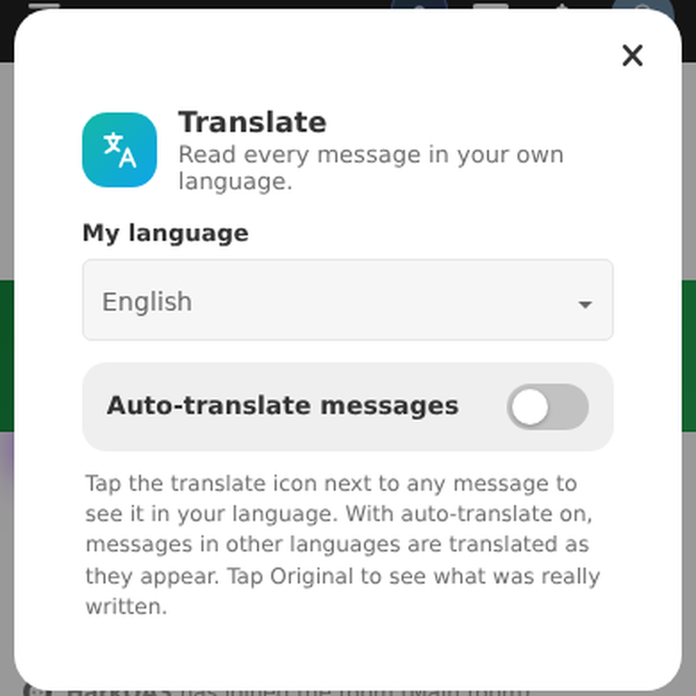
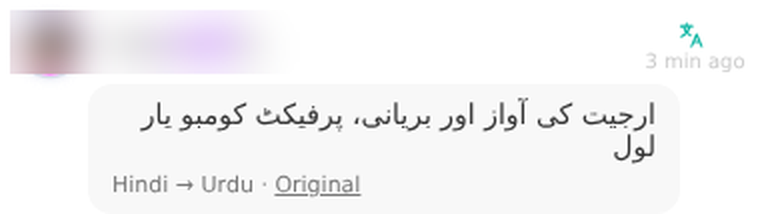

# 🌐 Translate for Codychat 10.1

Every member reads the chat in their own language. Tap the translate icon on any message, or turn on auto-translate and messages in other languages are translated as they arrive.

**Author:** M Kashif · **License:** MIT · **Tested on:** Codychat 10.1

## Screenshots

| Member settings | Translated message |
|---|---|
|  |  |

## Features
- Translate icon next to every message, in rooms and private chats
- Each member picks **their own language**, guests included
- **Auto-translate** switch per member
- **Original** link to see what was really written
- Translations are cached in your database, so a message is translated once per language
- Rate limit per member to stop abuse
- **Free by default**: uses Google's public translate endpoint, so no API key is needed
- Optional **Microsoft Azure Translator** key for heavy traffic, with automatic fallback between engines

## Requirements
- Codychat **10.1** (official build, all three chat styles: bubble, text and compact)
- PHP 8.0+ (tested on 8.3) with the **cURL** extension
- MySQL/MariaDB
- Your server must be able to make outgoing HTTPS requests to `translate.googleapis.com` (or Azure if you use it)

## Installation
1. Download the repo and unzip it.
2. Upload the folder **`cnr_translate`** into your chat's `addons/` folder:
   ```
   your-chat/addons/cnr_translate/
   ```
3. Log in as **owner** → **Admin panel → Add-ons** → **Translate** → **Install**.
4. Refresh the chat. A translate icon now shows on messages.

The installer creates two tables, `cnr_tr_cache` and `cnr_tr_pref`. Uninstalling removes them.

## How members use it
1. Tap your **avatar** (top right) → **Chat options** (gear) → **Translate**.
2. Choose **My language** and, if you like, switch on **Auto-translate messages**.
3. Or just tap the translate icon on any single message.

## Settings (Admin panel → Add-ons → Translate → Settings)
| Setting | Default | Meaning |
|---|---|---|
| Translate on this site | On | Turn the feature on or off |
| Translation engine | Google (free) | Or Azure if you add a key |
| Azure key / region | empty | Only needed for the Azure engine |
| Lowest rank that can translate | Guest | Who sees the translate icon |
| New translations per member per minute | 40 | Abuse protection. Cached translations don't count |

## Troubleshooting
| Problem | Fix |
|---|---|
| No translate icon | Hard-refresh (Ctrl+F5) and check the add-on is on |
| "Translation failed" | Your server can't reach Google. Check that cURL is installed and outgoing HTTPS is allowed, or add an Azure key |
| Slow at peak times | Add an Azure Translator key (free tier: 2M characters a month) |

## Need help or a different Codychat version?
Paid installation and adaptation for **Codychat 11 or older versions** is available. Open an [issue](../../issues/new) titled **"Paid install help"**.

⭐ If you like it, **star the repo** and **follow M Kashif on GitHub**.
